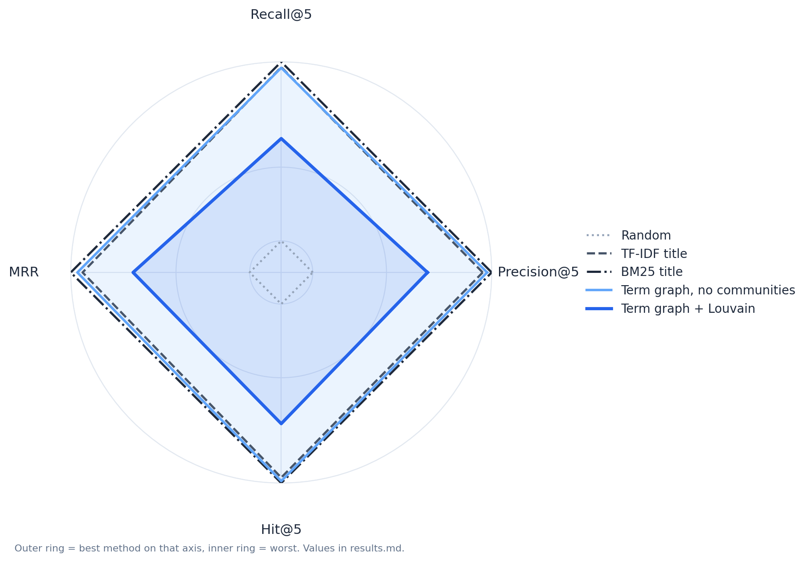

# NIPS Paper Recommendation

## Benchmark results

Three random splits, each with 20% of the papers as queries (about 1,270 to 1,315 queries per split). Mean ± standard deviation over the three splits. Higher is better for every column. Random, TF-IDF title and BM25 title are the baselines; the two term-graph rows are the methods under test.

Definitions are in [`docs/PROBLEM.md`](docs/PROBLEM.md), [`docs/METHODS.md`](docs/METHODS.md), [`docs/METRICS.md`](docs/METRICS.md) and [`docs/RESULTS.md`](docs/RESULTS.md); [`docs/INDEX.md`](docs/INDEX.md) maps them to the code.

| Method | Precision@5 | Recall@5 | MRR | Hit@5 |
|---|---:|---:|---:|---:|
| Random | 0.0026 ± 0.0005 | 0.0007 ± 0.0002 | 0.0068 ± 0.0013 | 0.0129 ± 0.0025 |
| TF-IDF title | 0.0464 ± 0.0021 | 0.0344 ± 0.0025 | 0.1216 ± 0.0094 | 0.1922 ± 0.0102 |
| BM25 title | 0.0487 ± 0.0017 | 0.0354 ± 0.0017 | 0.1297 ± 0.0086 | 0.1978 ± 0.0091 |
| Term graph + Louvain (the app's design) | 0.0322 ± 0.0019 | 0.0205 ± 0.0021 | 0.0869 ± 0.0059 | 0.1365 ± 0.0079 |
| Term graph, no communities | 0.0475 ± 0.0027 | 0.0342 ± 0.0021 | 0.1252 ± 0.0099 | 0.1958 ± 0.0116 |

<p align="center">
  
  <br><em>Figure 1. Benchmark metrics as a radar chart. Each axis is scaled so that the outer edge is the best method on that metric.</em>
</p>

## Example queries

Top three papers for each query, one column per method. Bold words are title terms shared with the query. The full top five are in [`results/examples.md`](results/examples.md).

**"Support vector machines for classification"**

| Rank | TF-IDF title | BM25 title | Term graph + Louvain | Term graph, no communities |
|---:|---|---|---|---|
| 1 | **Support Vector** Regression **Machines** (1996) | **Support Vector** Regression **Machines** (1996) | Adaptive Nearest Neighbor **Classification** Using **Support Vector Machines** (2001) | Adaptive Nearest Neighbor **Classification** Using **Support Vector Machines** (2001) |
| 2 | Model Selection for **Support Vector Machines** (1999) | Sex with **Support Vector Machines** (2000) | Active **Support Vector** Machine **Classification** (2000) | **Support Vector** Regression **Machines** (1996) |
| 3 | 1-norm **Support Vector Machines** (2003) | 1-norm **Support Vector Machines** (2003) | **Support Vector** Machine **Classification** with Indefinite Kernels (2007) | Model Selection for **Support Vector Machines** (1999) |

**"Gaussian processes for regression"**

| Rank | TF-IDF title | BM25 title | Term graph + Louvain | Term graph, no communities |
|---:|---|---|---|---|
| 1 | **Gaussian Processes** for **Regression** (1995) | **Gaussian Processes** for **Regression** (1995) | **Gaussian Processes** for **Regression** (1995) | **Gaussian Processes** for **Regression** (1995) |
| 2 | **Gaussian Processes** in Reinforcement Learning (2003) | Robust **Regression** with Twinned **Gaussian Processes** (2007) | Robust **Regression** with Twinned **Gaussian Processes** (2007) | Robust **Regression** with Twinned **Gaussian Processes** (2007) |
| 3 | Robust **Regression** with Twinned **Gaussian Processes** (2007) | Discovering Hidden Features with **Gaussian Processes Regression** (1998) | Discovering Hidden Features with **Gaussian Processes Regression** (1998) | Discovering Hidden Features with **Gaussian Processes Regression** (1998) |

**"Reinforcement learning with function approximation"**

| Rank | TF-IDF title | BM25 title | Term graph + Louvain | Term graph, no communities |
|---:|---|---|---|---|
| 1 | Active **Learning** for **Function Approximation** (1994) | **Reinforcement Learning** with **Function Approximation** Converges to a Region (2000) | **Reinforcement Learning** with **Function Approximation** Converges to a Region (2000) | Policy Gradient Methods for **Reinforcement Learning** with **Function Approximation** (1999) |
| 2 | Policy Gradient Methods for **Reinforcement Learning** with **Function Approximation** (1999) | Policy Gradient Methods for **Reinforcement Learning** with **Function Approximation** (1999) | Sketch-Based Linear Value **Function Approximation** (2012) | Optimality of **Reinforcement Learning** Algorithms with Linear **Function Approximation** (2002) |
| 3 | Optimality of **Reinforcement Learning** Algorithms with Linear **Function Approximation** (2002) | Convergent Combinations of **Reinforcement Learning** with Linear **Function Approximation** (2002) | Bayes-Adaptive Simulation-based Search with Value **Function Approximation** (2014) | **Reinforcement Learning** with **Function Approximation** Converges to a Region (2000) |

**"Convolutional networks for image recognition"**

| Rank | TF-IDF title | BM25 title | Term graph + Louvain | Term graph, no communities |
|---:|---|---|---|---|
| 1 | Natural **Image** Denoising with **Convolutional Networks** (2008) | Natural **Image** Denoising with **Convolutional Networks** (2008) | Natural **Image** Denoising with **Convolutional Networks** (2008) | Natural **Image** Denoising with **Convolutional Networks** (2008) |
| 2 | **Convolutional** Kernel **Networks** (2014) | Two-Stream **Convolutional Networks** for Action **Recognition** in Videos (2014) | Learning **Convolutional** Feature Hierarchies for Visual **Recognition** (2010) | Deep **Convolutional** Neural Network for **Image** Deconvolution (2014) |
| 3 | Diffusion-**Convolutional** Neural **Networks** (2016) | **Convolutional** Kernel **Networks** (2014) | Two-Stream **Convolutional Networks** for Action **Recognition** in Videos (2014) | Learning **Convolutional** Feature Hierarchies for Visual **Recognition** (2010) |

## Data

`data/` holds the NIPS papers from 1987 to 2017: 7,238 papers, 9,784 authors and 20,838 paper–author links, from the Kaggle "NIPS Papers" dataset.

## Run

```bash
pip install -r requirements.txt
python -m scripts.benchmark --data data --out results --seeds 0 1 2
python -m scripts.plot_radar --results results
python -m scripts.examples --data data --out results
```

The benchmark takes about 4 minutes on a laptop CPU. It writes `results/results.md` and `results/results.json`.
