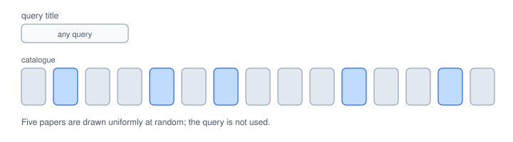
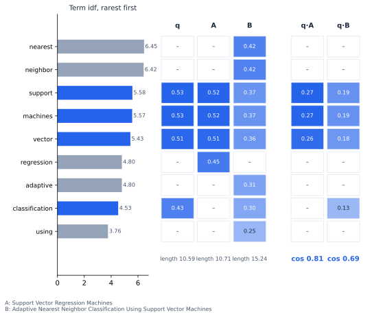
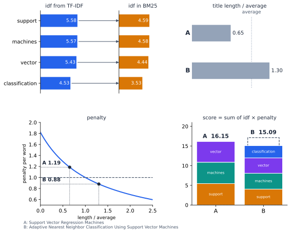
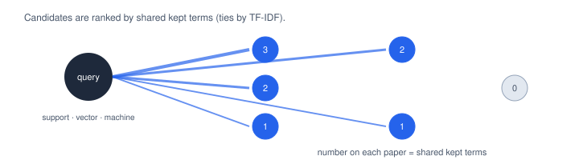
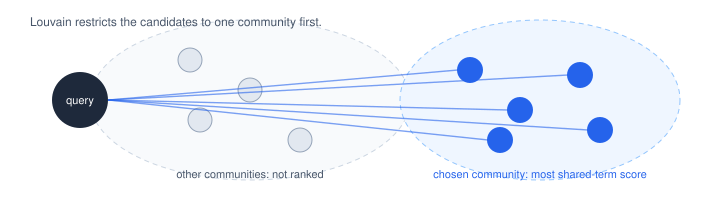

# Methods

Each method takes a query title and returns five catalogue papers. The code for each one is in `paperrec/methods/`. Each method reads an indexed `Catalogue` (`paperrec/catalogue.py`). The term graph is built in `paperrec/graph.py`.

Random, TF-IDF and BM25 are the baselines. The two term-graph methods are the ones under test. The version without communities is the ablation of the app's design.

## 1. Random

Pick five catalogue papers at random. The query is ignored. Every real method should beat this.

  
   <em>Figure 1. Random: five papers are picked at random, whatever the query.</em>

## 2. TF-IDF title

**Idea.** A word that appears in few titles says more than a common word such as "learning". Each title gets a weight for each of its words. A word counts more if it is in the title often and in few catalogue titles overall. Two titles are similar when their weights point the same way.

**Score.** The cosine between the query's weights and the paper's weights:

$$
\mathrm{score}(q,d) = \cos(w_q, w_d)
$$

For each word $t$, the weight is

$$
w(t,d) = \mathrm{tf}(t,d)\cdot \mathrm{idf}(t), \qquad \mathrm{idf}(t) = \ln\frac{1+N}{1+\mathrm{df}(t)} + 1
$$

- $\mathrm{tf}(t,d)$: how often word $t$ is in title $d$.
- $N$: number of catalogue titles.
- $\mathrm{df}(t)$: number of catalogue titles that contain $t$.

Stop words such as "for" are removed. A query word the catalogue never uses adds nothing.

**Why a long title scores lower.** Every word adds weight to the title, so a long title has a large total. The cosine divides by that total, so each shared word is worth less.

  
   <em>Figure 2. TF-IDF on one query. Each row is a word, rarest first. Shaded cells are each title's normalised weight for that word. The products q·A and q·B add up to the cosines, 0.81 for A and 0.69 for B. B's weight is spread over more words, so each shared word is smaller.</em>

## 2b. BM25 title

**Idea.** The same idea as TF-IDF, with two changes. A word counts once, however often it appears. A title is penalised only when it is longer than the average title.

**Score.** Add up the query words that the title contains:

$$
\mathrm{score}(q,d) = \sum_{t \in q \cap d} \mathrm{idf}(t)\cdot \frac{k_1+1}{1 + k_1\left(1 - b + b\,\dfrac{|d|}{\mathrm{avgdl}}\right)}
$$

$$
\mathrm{idf}(t) = \ln\left(1 + \frac{N - \mathrm{df}(t) + 0.5}{\mathrm{df}(t) + 0.5}\right)
$$

- The idf is rarity: a word in few titles adds more.
- The fraction after the idf is the length penalty, applied to each word. $|d|$ is the number of words in title $d$, and $\mathrm{avgdl}$ is the average over the catalogue.
- $k_1 = 1.5$ and $b = 0.75$.

The penalty is 1.00 for an average-length title and 0.69 for a title twice the average. With $b = 0$ there is no penalty.

  
   <em>Figure 2b. BM25 on the same query. BM25 uses the same rarity idea, so each word keeps its TF-IDF idf as the starting point; the arrows link them, with BM25's own formula. Each title's length against the average gives its penalty, and each shared word scores its idf times that penalty. A scores 16.15 and B scores 15.09.</em>

## 3. Term graph

**Terms.** A title's terms are its lower-case words of at least two letters, without stop words. Words in more than 5% of the catalogue (about 290 titles) are dropped, because they link almost every pair of papers.

**Graph.** Each catalogue paper is a node. Two papers are linked, with a weight equal to the number of kept words they share. In seed 0 the graph has 5,791 nodes and 743,316 edges.

**Ranking.** Each paper's score is the number of kept words it shares with the query. Ties are broken by TF-IDF cosine.

  
   <em>Figure 3. Term graph: each paper is scored by the number of kept words it shares with the query. Papers with no shared word are not candidates.</em>

### 3a. Term graph + Louvain (the app's design)

Louvain splits the graph into groups of papers that share many words. In seed 0 there are 32 groups, with modularity 0.342. For the query, the group with the largest total shared-word score is chosen, and only its papers can be returned. If the query shares no kept word with the catalogue, the method falls back to TF-IDF.

  
   <em>Figure 4. Term graph + Louvain: only the group with the largest shared-word score is searched. Papers in other groups cannot be returned for that query.</em>

### 3b. Term graph, no communities

The same score as Figure 3, over all papers that share a kept word with the query.
