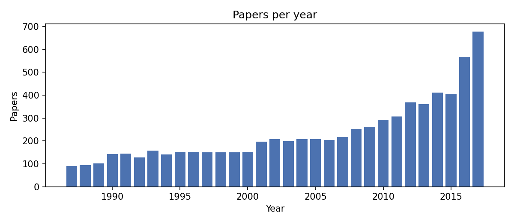
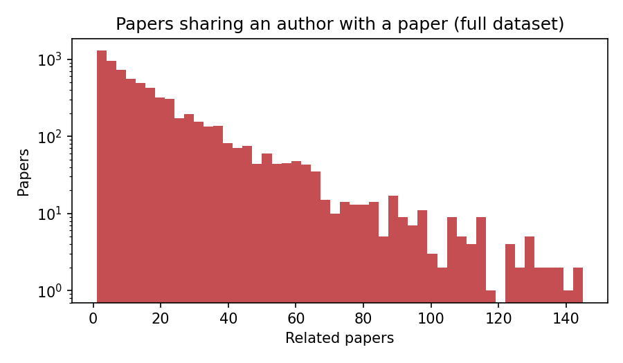

# Problem

## 1. Task

Given the title of a paper, return the five catalogue papers most related to it. A reader who has one paper in hand can use the list to find related work.

## 2. Data

- Source: the NIPS papers dataset (Kaggle), covering 1987 to 2017.
- `papers.csv`: 7,238 papers with `id`, `year`, `title`, `event_type` and `authors`.
- `authors.csv`: 9,784 authors. `paper_authors.csv`: 20,838 links between papers and authors.
- Every paper has a title and at least one linked author.

  
   <em>Figure 1. Papers per year in the dataset. Output rises sharply after 2010, so the later years make up much of the data.</em>

## 3. Split

For each seed, 20% of the papers with at least one author are drawn as queries. The other 80% form the catalogue, which is the only pool any method may return. The catalogue has 5,791 papers in seed 0. Three seeds (0, 1, 2) are used.

## 4. Relevance

A catalogue paper is relevant to a query when the two share at least one author. Queries with no relevant catalogue paper are dropped (about 130 of 1,447 per split in seed 0, leaving 1,315 evaluated).

This is a proxy. It assumes that papers by a shared author are related, which is often true but not always. It does not measure whether a reader finds the list useful.

  
   <em>Figure 2. Other papers sharing an author with each paper, over the full dataset. The median is 10; about 9% of papers have none, so they can never be a relevant match.</em>

## 5. Why the graph does not use authors

The graph uses title terms only. Author links would already encode the relevance signal and would reward the graph for that, so the graph and TF-IDF both see only titles.

## 6. Limits

- Relevance is a proxy (section 4).
- The query is a paper title that is already in the dataset. A real user might type a sentence instead.
