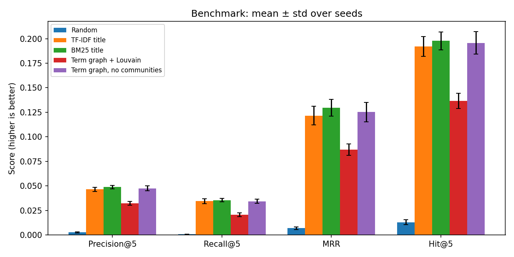
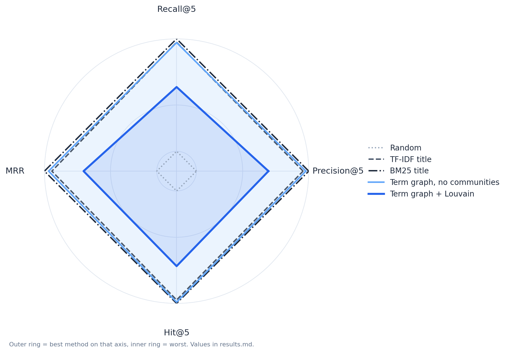

# Results

Source: `results/results.md` and `results/results.json`, produced by `python -m scripts.benchmark --data data --out results --seeds 0 1 2`.

## 1. Main table

| Method | Precision@5 | Recall@5 | MRR | Hit@5 |
|---|---:|---:|---:|---:|
| Random | 0.0026 ± 0.0005 | 0.0007 ± 0.0002 | 0.0068 ± 0.0013 | 0.0129 ± 0.0025 |
| TF-IDF title | 0.0464 ± 0.0021 | 0.0344 ± 0.0025 | 0.1216 ± 0.0094 | 0.1922 ± 0.0102 |
| BM25 title | 0.0487 ± 0.0017 | 0.0354 ± 0.0017 | 0.1297 ± 0.0086 | 0.1978 ± 0.0091 |
| Term graph + Louvain | 0.0322 ± 0.0019 | 0.0205 ± 0.0021 | 0.0869 ± 0.0059 | 0.1365 ± 0.0079 |
| Term graph, no communities | 0.0475 ± 0.0027 | 0.0342 ± 0.0021 | 0.1252 ± 0.0099 | 0.1958 ± 0.0116 |

Queries per split: 1,315, 1,286 and 1,268.

  
   <em>Figure 1. Mean and standard deviation over seeds 0, 1 and 2, for each method and metric. Random sets the floor. BM25 title is highest on every metric, but its margin over the other lexical methods is within about one standard deviation.</em>

  
   <em>Figure 2. The same scores on one radar. Each axis is scaled across the methods, so the chart shows relative position only.</em>

## 2. Reading

- **Against random.** TF-IDF's Precision@5 is about 18 times the random value, and its Hit@5 is about 15 times. Both are well above the seed spread.
- **Lexical methods.** BM25 title is highest on all four metrics, followed by the term graph without communities and TF-IDF title. The gaps between these three are about one standard deviation, so they are not reliable differences.
- **Community step.** Restricting to the Louvain community lowers Precision@5 by about a third (0.0322 against 0.0475). The app uses this step, so its recommendations are weaker on this proxy than the no-community ranking.

## 3. Limits

- Relevance is a shared-author proxy (see [`PROBLEM.md`](PROBLEM.md) §4). A different proxy could change the ranking of the methods.
- Three splits are not a confidence interval for a new dataset.
- Sentence embeddings are not in the benchmark, so no embedding-based recommender has been evaluated.
